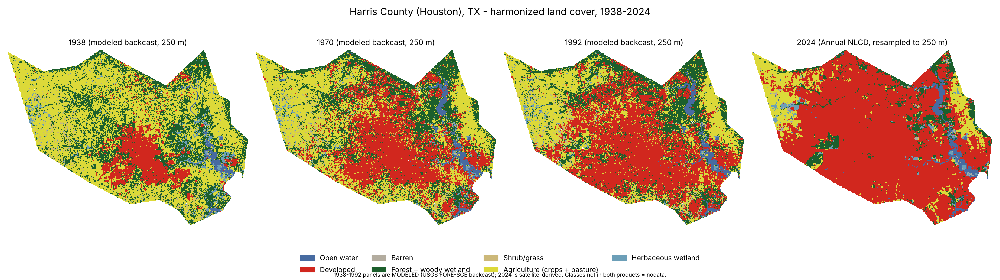
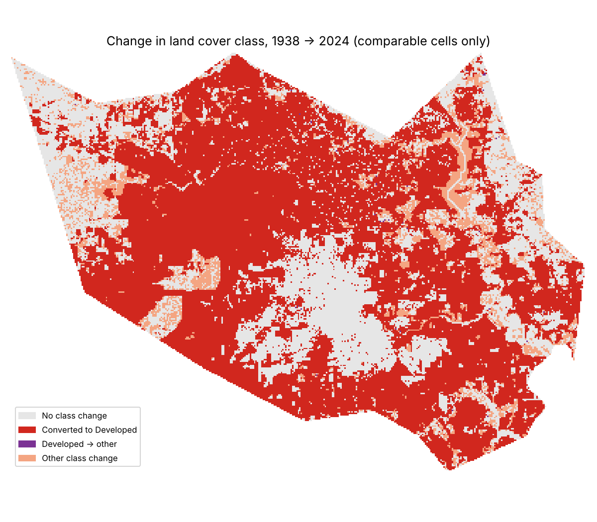
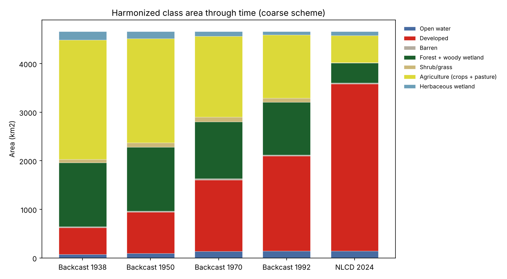

# Houston land use / land cover change, 1938 - 2024

Maps and tables of land cover change for **Harris County, Texas (Houston)**, built only from
public data and open-source Python. Pilot for a wider Gulf Coast analysis.



## Read this first: what 1938-1992 actually is

No satellite-derived land cover map exists for the U.S. before the 1970s. The 1938-1992 layers are a
**USGS modeled backcast** (FORE-SCE), reconstructed backwards from a modified 1992 NLCD using the Census of
Agriculture, housing density and other sources. 1985-2024 is Annual NLCD, derived from Landsat. The two
products therefore differ in method as well as resolution, so changes across 1992 mix real change with
product differences.

I measured this using the 1985 overlap year (both products exist): the two products agree on only
**64.2 %** of cells with the detailed classes and **72.3 %** with the coarse scheme. The backcast puts
about 20 % less area in *Developed* than NLCD 1985 (1,858 vs 2,324 km2), roughly twice as much forest, and
almost no woody wetland (25 vs 265 km2). Trends 1938-1992 (within one product) are the most
reliable; the headline 1938 -> 2024 totals are inflated or deflated by this discontinuity.
See `outputs/overlap_check_1985.csv` and `outputs/overlap_1985_confusion_coarse_km2.csv`.

## Data

| Role | Dataset | Resolution | Link |
|---|---|---|---|
| 1938-1992 | USGS Modeled Historical LULC, CONUS (Sohl et al. 2018) | 250 m, EPSG:5070 | [ScienceBase](https://www.sciencebase.gov/catalog/item/59d3c73de4b05fe04cc3d1d1), DOI 10.5066/F7KK99RR |
| 1985-2024 | Annual NLCD Collection 1.1 Land Cover | 30 m, Albers | [MRLC](https://www.mrlc.gov/data), DOI 10.5066/P94UXNTS |
| Boundary | Harris County, TX (FIPS 48201), Census cartographic boundary as redistributed in [plotly/datasets](https://github.com/plotly/datasets) | vector | public domain source data |

Both land cover products are U.S. Government works with no use restrictions.
Years used: backcast 1938, 1950, 1970, 1985, 1992; NLCD 1985 and 2024 (the latest in Collection 1.1 at time of writing).

## Method

1. Clip to Harris County on the 250 m backcast grid (EPSG:5070, equal-area, 0.0625 km2 per cell).
2. Crosswalk both legends to the classes they share; unmatched classes (backcast *Mining*,
   *Perennial ice*, unused codes) become nodata, as do cells outside the county.
3. Resample NLCD 30 m -> 250 m with **majority (mode)** resampling. This is the usual choice
   for categorical rasters but it erases small patches (see Shrub/grass below).
4. Area tables, transition matrices, change map. A **coarse scheme** merges the classes the
   products disagree on most (forest + woody wetland, shrub + grass, crops + pasture).

## Results (Harris County, km2, coarse scheme)

| Class | 1938* | 1950* | 1970* | 1992* | 2024 |
|---|---:|---:|---:|---:|---:|
| Open water | 75.9 | 92.2 | 136.4 | 142.1 | 145.0 |
| Developed | 546.1 | 853.8 | 1,473.5 | 1,959.4 | 3,438.3 |
| Barren | 22.8 | 23.2 | 23.4 | 23.4 | 20.4 |
| Forest + woody wetland | 1,314.0 | 1,315.9 | 1,170.9 | 1,084.9 | 413.2 |
| Shrub/grass | 70.0 | 84.1 | 95.8 | 79.9 | 4.3 |
| Agriculture (crops + pasture) | 2,461.1 | 2,149.9 | 1,663.6 | 1,307.2 | 555.4 |
| Herbaceous wetland | 173.9 | 144.9 | 99.7 | 66.3 | 88.8 |

\* modeled backcast, not observed. Detailed-class tables: `outputs/class_area_km2.csv`.

What can be said with reasonable confidence: Developed area grew roughly six-fold and agricultural land fell
by about 77 %, consistent with Houston's growth; within the backcast alone, Developed grew from 546 to
1,959 km2 (1938-1992). What should not be over-read: the 1992 -> 2024 forest and shrub/grass declines
(partly a definition/resampling effect; NLCD 2024 maps almost no shrub/grass at 250 m majority) and the
exact 1938 -> 2024 transition amounts.




## Reproduce

```
pip install -r requirements.txt
python src/fetch_data.py data/raw      # ~3 GB download (two NLCD zips)
python src/analyze.py data/raw
python src/figures.py
```

## Limitations / not verified

- Study area is the county polygon, which includes bay/water area; it is not the City of Houston limits.
- No independent ground truth was used; the 1985 comparison measures agreement between two
  products, not accuracy against reality.
- Annual NLCD classes for 1985-2024 were not cross-checked for temporal noise; only 1985 and 2024 are used.
- Not yet extended to the full Gulf Coast; only the boundary and the clip window change for that.
